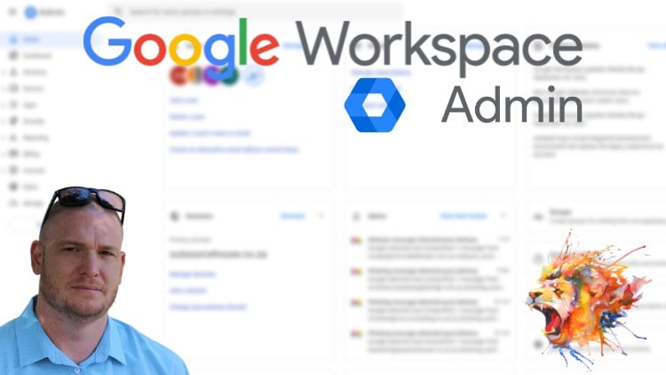

# Taming Google Workspace (G Suite) - An Administrator Guide

This folder holds the reference pages, examples and checklists for the Google Workspace Admin course on Udemy. The lessons link here, so you can read the full detail without pausing the video.

**Enrol:** [taming.tech/GoogleWorkspaceAdmin](https://taming.tech/GoogleWorkspaceAdmin)

## What the course covers
- Setting up a Google Workspace trial, including DNS settings, MX, SPF, DMARC and DKIM records
- Advanced security, including email security, password security, people security, less secure apps, MFA and SSO
- Users and groups, including OU structure, admin roles, suspending and restoring users, deleting and undeleting users
- Managing the core apps, including the directory, Calendar, Gmail, and Drive and Docs
- Mail flow, including routing settings, default routing, sending and receiving routing, content compliance and attachment compliance
- Device management, including the Apple push certificate for iOS, company-owned devices and work profiles

## In this folder
| File | Lesson | What it is |
|---|---|---|
| [Alerts and Rules.md](Alerts%20and%20Rules.md) | Rules and alerts | The alerts worth turning on, one activity rule to build, and which plans include which rule types |
